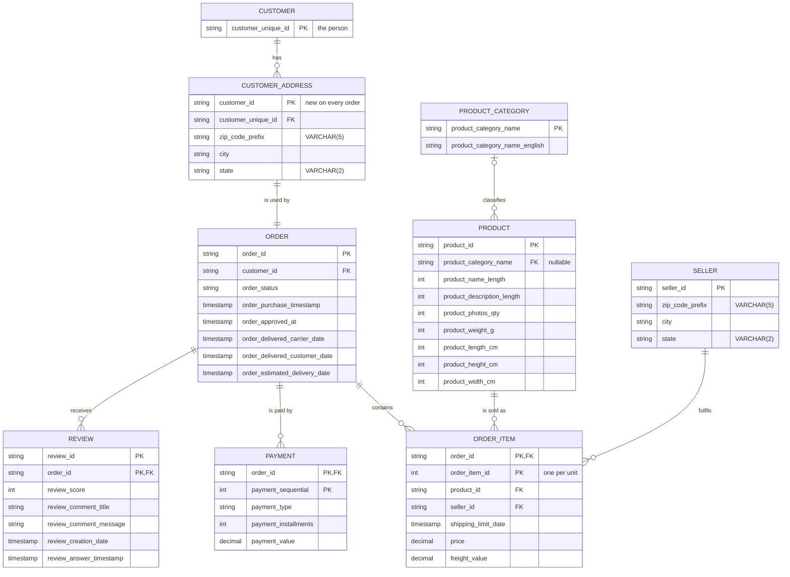
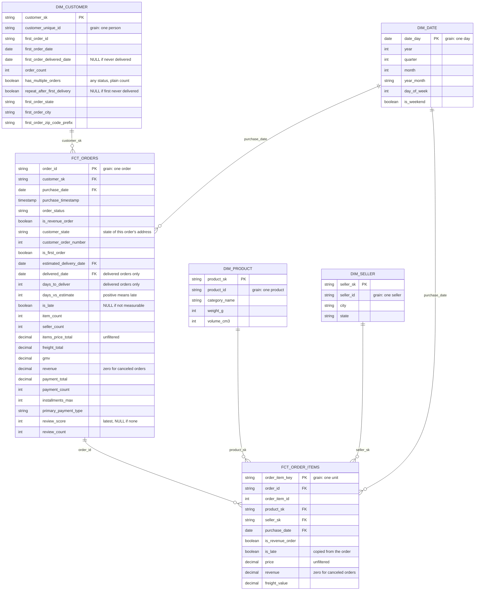

# Data model

How the Olist data is organised in Snowflake, from the raw files to the star schema. The D numbers point to [`decision_log.md`](decision_log.md), and the figures come from [`relationship_checks.sql`](relationship_checks.sql) and [`type_and_design_checks.sql`](type_and_design_checks.sql).

The idea in one line: normalise in staging so each fact lives in one place, then denormalise into a star in the marts so a business question is one join away.

## 1. Layers

All layers live in the database `ELIO_OLIST`, built by the role `ELIO_TRANSFORMER` on the X-Small warehouse `ELIO_WH` (auto-suspends after 60 seconds).

| Schema | Built by | Materialised as | Holds | Purpose |
|---|---|---|---|---|
| `RAW` | `ingest/` scripts | Tables | 8 tables, one per CSV, all `VARCHAR`, plus `_source_file`, `_source_row` and `_loaded_at` | The files exactly as received. Never edited. |
| `STAGING` | dbt | Views | 8 models, `stg_olist__<entity>`, 1:1 with `RAW` | Typed, renamed, de-duplicated. Normalised (3NF). Natural keys. |
| `INTERMEDIATE` | dbt | Views | 4 models, `int_*` | Roll each child table up to **order grain** (the fan-out fix), and rank each person's orders. |
| `MARTS` | dbt | Tables | 4 dimensions and 2 facts: `dim_*`, `fct_*` | The star schema. Surrogate keys, documented columns, enforced contracts. |

Views stay current and can be queried while debugging; the marts are tables because that's what analysts hit (D03). A `generate_schema_name` override keeps the schema names exact (D02).

## 2. What the marts must answer (the design works backwards from this)

| Question | Needs | From |
|---|---|---|
| Top 10 categories by revenue, with share of total | price per item, its category, whether it counts as revenue | `fct_order_items` and `dim_product` |
| Monthly orders, revenue and average order value, month on month | purchase date, order revenue, revenue flag | `fct_orders` and `dim_date` |
| Anomalies: sellers with a high late rate, orders with extreme delivery days | seller per item, late flag, days to deliver | `fct_order_items`, `fct_orders` and `dim_seller` |
| Breakdown by state: delivery days, late %, review, freight ratio | state per order, days to deliver, late flag, score, freight and price totals | `fct_orders` |
| Repeat rate by first-order experience | person, order number, first order's lateness and score | `dim_customer` and `fct_orders` |
| Insight 1: late delivery against review score | late flag, days vs estimate, score | `fct_orders` |

## 3. Staging: the 3NF model

The conceptual model, in third normal form. In 3NF every column depends on the key, the whole key, and nothing but the key.



### Where each entity comes from

| Entity | Key | Grain | Comes from | dbt model |
|---|---|---|---|---|
| `CUSTOMER` | `customer_unique_id` | One person (96,096) | Derived from the customers file | `int_customer_orders` (D05) |
| `CUSTOMER_ADDRESS` | `customer_id` | One customer-at-order (99,441), used by exactly one order | `olist_customers_dataset.csv` | `stg_olist__customers` |
| `ORDER` | `order_id` | One order (99,441) | `olist_orders_dataset.csv` | `stg_olist__orders` |
| `ORDER_ITEM` | `(order_id, order_item_id)` | One unit on an order (112,650) | `olist_order_items_dataset.csv` | `stg_olist__order_items` |
| `PAYMENT` | `(order_id, payment_sequential)` | One payment (103,886) | `olist_order_payments_dataset.csv` | `stg_olist__order_payments` |
| `REVIEW` | `(review_id, order_id)` | One review of an order (99,224) | `olist_order_reviews_dataset.csv` | `stg_olist__order_reviews` |
| `PRODUCT` | `product_id` | One product (32,951) | `olist_products_dataset.csv` | `stg_olist__products` |
| `PRODUCT_CATEGORY` | `product_category_name` | One category (71) | `product_category_name_translation.csv` | `stg_olist__product_category_translation` |
| `SELLER` | `seller_id` | One seller (3,095) | `olist_sellers_dataset.csv` | `stg_olist__sellers` |

### Why this is 3NF

- **1NF:** every column holds one value, and every table has a key.
- **2NF (no partial dependencies):** in the tables with composite keys (`ORDER_ITEM`, `PAYMENT`, `REVIEW`), each non-key column depends on the whole key. A product's weight is not stored on the item; it lives on `PRODUCT`. A seller's city is not on the item; it lives on `SELLER`.
- **3NF (no transitive dependencies):** a category's English name depends on the category, not on the product, so it lives in `PRODUCT_CATEGORY`. A person is separated from their per-order address, because `customer_id` is new on every order while the person is not.
- **Many-to-many resolved:** an order has many products and a product is on many orders, so `ORDER_ITEM` resolves it (and adds the seller). A review id can span several orders and an order can have several reviews, so `REVIEW`, keyed by both, resolves it.

### The deliberate break from 3NF (D24)

City and state stay on the address (and on the seller) rather than in a zip-prefix table, because here a zip prefix doesn't decide the city or state:

| | Zip prefixes | With more than 1 city | With more than 1 state |
|---|---:|---:|---:|
| Customers | 14,994 | 39 | 0 |
| Sellers | 2,246 | 34 | 17 |


## 4. Column types in staging (D07, D08)

Every type was checked against the loaded data first. Each column's type is set in the staging SQL through three small macros (D34). The rules:

| Kind | Type | Why |
|---|---|---|
| Identifiers | `VARCHAR(32)` | All exactly 32 characters, no blanks |
| State | `VARCHAR(2)` | Always two letters |
| Zip prefix | `VARCHAR(5)` | Text, so the leading zero stays (D08) |
| Timestamps | `TIMESTAMP_NTZ` | The source has no time zone (D09); estimated delivery dates always sit at midnight (D18) |
| Money | `NUMBER(12,2)` | Never more than 2 decimals |
| Counts and lengths | `NUMBER(10,0)` | Whole numbers only |
| Review score | `NUMBER(1,0)` | 1 to 5 |
| Free text | `VARCHAR` | No length, since it adds nothing in Snowflake |

## 5. Keys and tests (D10, D11)

Snowflake does not enforce primary or foreign keys, so every key is **proved with a dbt test**, and the marts additionally have an enforced contract.

| Layer | Keys | Tests |
|---|---|---|
| Staging | Natural keys, exactly as the source | `unique` and `not_null` on single keys; `unique_combination_of_columns` on `(order_id, order_item_id)`, `(order_id, payment_sequential)` and `(review_id, order_id)`; `relationships` on every foreign key; `accepted_values` on `order_status`, `payment_type` and `review_score` |
| Intermediate | Natural keys, at order grain (`int_customer_orders` at order grain too) | `unique` and `not_null` on `order_id` |
| Marts | Surrogate keys on the dimensions (`customer_sk`, `product_sk`, `seller_sk`) from a local `generate_surrogate_key` macro (D30, D42); `fct_orders` keyed on `order_id`, `fct_order_items` on a one-column hash `order_item_key` (D10) | `unique`, `not_null`, `relationships` from each fact to each dimension and to `dim_date` for every date column; enforced contracts (D38); reconciliation, one-first-order and golden-number checks and unit tests (below) |

On top of those, a few singular tests on the marts catch what key tests can't (D45): the row count of each mart, totals that reconcile with staging, exactly one first order per person, payments against items plus freight (a warning, D60), and golden numbers worked out from RAW before the marts existed. Unit tests give made-up inputs a known answer, to prove the tie-breaks, the lateness rule and the repeat definition.

## 6. Intermediate models: the fan-out fix (D14, D15, D29)

An order has up to 21 items, 29 payments and several reviews, so joining those straight onto orders repeats the order's row (one careless join pushes `SUM(payment_value)` up 26.9%). So each one is rolled up to **one row per order** first.

| Model | Grain | What it adds | Rule |
|---|---|---|---|
| `int_order_items_rollup` | One row per order that has items | `item_count`, `seller_count`, `items_price_total`, `freight_total` | Sums the item rows. Orders with no items are absent here and become 0 in the fact. |
| `int_order_payments` | One row per order that has payments | `payment_total`, `payment_count`, `installments_max`, `primary_payment_type` | The primary type is the one with the largest value, ties broken by `payment_sequential` (D43). |
| `int_order_reviews` | One row per order that has a review | `review_score`, `review_count`, review timestamps | The latest review by `review_answer_timestamp`, then `review_id`. |
| `int_customer_orders` | One row per order | `customer_unique_id`, `order_number`, and the address used on that order | Orders ranked per person by purchase timestamp, ties broken by `order_id` (D13). Shared by `dim_customer` and `fct_orders`, which derives `is_first_order` from it. |

## 7. The star schema (marts)



| Table | Grain | Primary key | Built from |
|---|---|---|---|
| `fct_orders` | One order | `order_id` | `stg_olist__orders` plus `LEFT JOIN`s to the four `int_` models; `customer_sk` is computed with the same macro as `dim_customer` (D41) |
| `fct_order_items` | One unit on an order | `order_item_key` (hash of `order_id` and `order_item_id`) | `stg_olist__order_items`, with the order-level flags from `fct_orders` (D48) |
| `dim_customer` | One person (`customer_unique_id`) | `customer_sk` | `int_customer_orders` and `fct_orders` (D12, D46) |
| `dim_product` | One product | `product_sk` | `stg_olist__products` and the category translation (D22) |
| `dim_seller` | One seller | `seller_sk` | `stg_olist__sellers` (D23) |
| `dim_date` | One day, 2016-01-01 to 2018-12-31 | `date_day` | Generated with Snowflake's `GENERATOR` (D25, D40) |

Orders are the spine: `fct_orders` starts from **every** order and `LEFT JOIN`s the rest, so orders with no items, payments or reviews are kept with counts of 0 and a NULL score (D21).

## 8. Metric definitions

Each one is defined once here and built once in the marts, so every query means the same thing.

| Metric | Definition |
|---|---|
| `is_revenue_order` | Status is not `canceled` or `unavailable` (D17) |
| Revenue | `SUM(revenue)`: the item price on revenue orders, 0 elsewhere, no freight (D16, D47) |
| `gmv` | `price + freight_value` |
| `payment_total` | `SUM(payment_value)` per order: cash collected, kept apart from revenue |
| Average order value | Revenue divided by the revenue orders with at least one item, 98,199 of them (D47) |
| `days_to_deliver` | Calendar days from purchase to delivery, delivered orders only (D19) |
| `days_vs_estimate` | Calendar days from the estimated to the actual delivery; positive means late |
| `is_late` | `days_vs_estimate > 0`, NULL when it can't be measured: 6,534 of 96,470 (6.77%) (D18) |
| `freight_ratio` | `freight_total` divided by `items_price_total` |
| `is_first_order` | The person's earliest order, ties broken by `order_id`, whatever its status (D13, D39) |
| `has_multiple_orders` | More than one order of any status: a plain count, not loyalty (D46) |
| `repeat_after_first_delivery` | A later non-canceled order on or after the first delivery day; NULL if the first order never arrived. 1,813 of 93,248 (1.94%) (D46) |
| Seller late rate | Late orders over measurable orders, counting distinct orders (D48) |

## 9. dbt layout

```
dbt_project/models/
  staging/olist/        _olist__sources.yml, _olist__models.yml, _olist__unit_tests.yml, stg_olist__*.sql  (8 views)
  intermediate/         _int__models.yml, _int__unit_tests.yml, int_*.sql              (4 views)
  marts/                _marts__models.yml, _marts__unit_tests.yml, dim_*.sql, fct_*.sql (6 tables)
dbt_project/macros/     generate_schema_name, olist_types, generate_surrogate_key
dbt_project/tests/      generic/unique_combination_of_columns, staging_row_counts_match_raw, raw_keys_are_unique,
                        marts_row_counts_match_staging, marts_totals_reconcile,
                        marts_one_first_order_per_person, marts_golden_numbers
```

Every mart column has a description.

## 10. Not modelled, on purpose

- **Geolocation:** the analysis works at state level, which customers and sellers already carry (D27).
- **Slowly changing dimension history:** the data is a static export, so a snapshot would show nothing (D28).
- **A time-zone conversion:** the source has no zone to convert from (D09).
