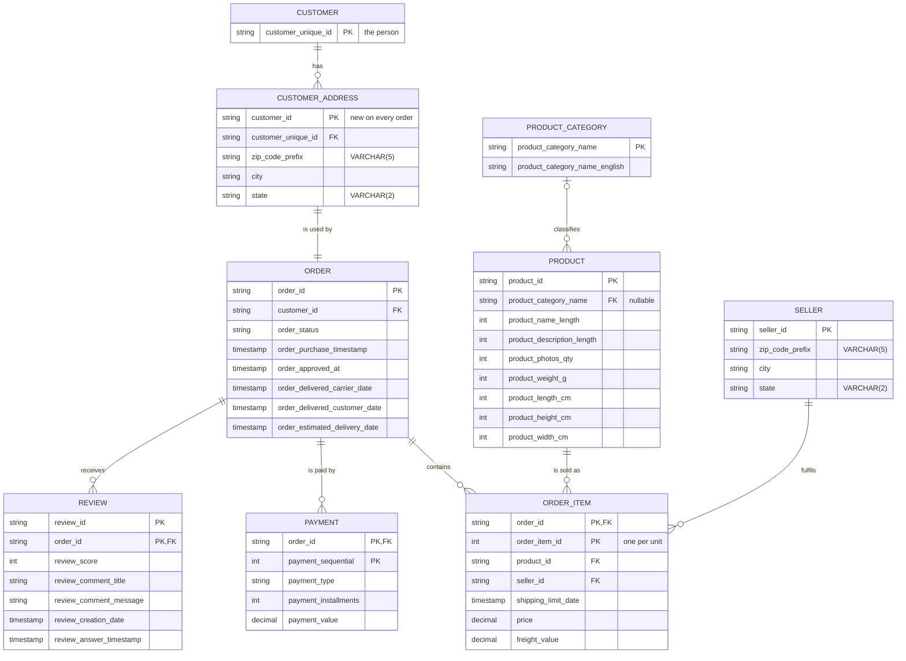
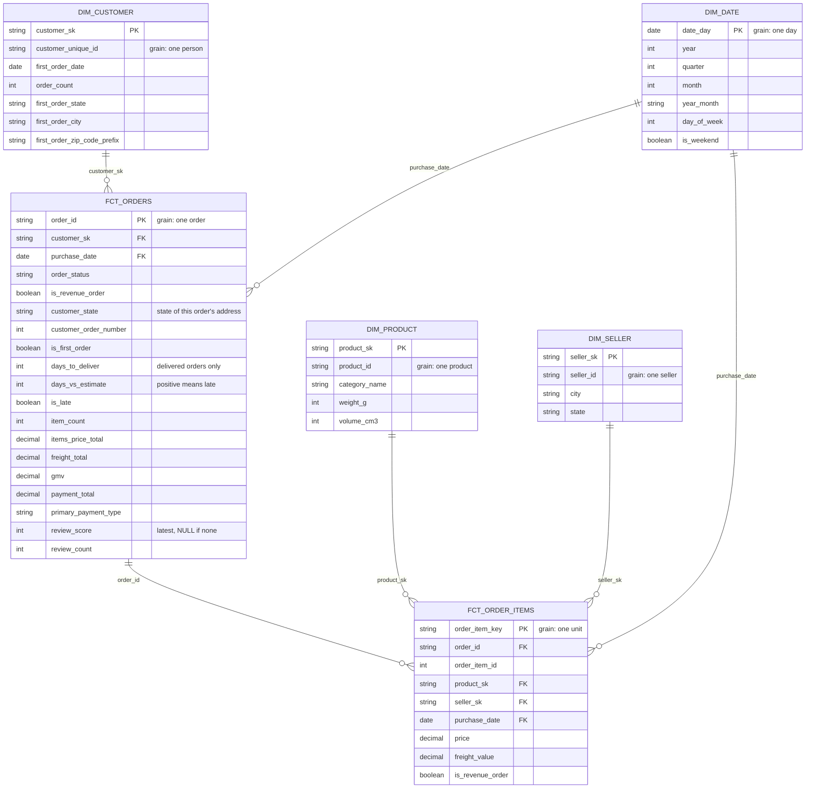

# Data model

How the Olist data is organised in Snowflake, from the raw files to the star schema the analysis reads. Each choice is argued in [`decision_log.md`](decision_log.md) (IDs like D07 below point there), and the numbers behind them are reproducible with [`relationship_checks.sql`](relationship_checks.sql) and [`type_and_design_checks.sql`](type_and_design_checks.sql).

**The one-line justification:** normalise in staging so each fact lives in one place and key tests mean something; denormalise to a star in the marts so a business question is one join away and fast.

## 1. Layers

All layers live in the database `ELIO_OLIST`, built by the role `ELIO_TRANSFORMER` on the X-Small warehouse `ELIO_WH` (auto-suspends after 60 seconds).

| Schema | Built by | Materialised as | Holds | Purpose |
|---|---|---|---|---|
| `RAW` | `ingest/` scripts | Tables | 8 tables, one per CSV, all `VARCHAR`, plus `_source_file`, `_source_row` and `_loaded_at` | The files exactly as received. Never edited. |
| `STAGING` | dbt | Views | 8 models, `stg_olist__<entity>`, 1:1 with `RAW` | Typed, renamed, de-duplicated. Normalised (3NF). Natural keys. |
| `INTERMEDIATE` | dbt | Views | 4 models, `int_*` | Roll each child table up to **order grain** (the fan-out fix), and rank each person's orders. |
| `MARTS` | dbt | Tables | 4 dimensions and 2 facts: `dim_*`, `fct_*` | The star schema. Surrogate keys, documented columns, enforced contracts. |

Why these materialisations (D03): staging views stay current and cost nothing; intermediate views (rather than `ephemeral`) can be queried and tested while debugging; mart tables are what analysts hit, so the join work is paid once. dbt creates the schemas, and a `generate_schema_name` override makes them named exactly `STAGING`, `INTERMEDIATE` and `MARTS` (D02).

## 2. What the marts must answer (the design works backwards from this)

| Question | Needs | From |
|---|---|---|
| Top 10 categories by revenue, with share of total | price per item, its category, whether it counts as revenue | `fct_order_items` and `dim_product` |
| Monthly orders, revenue and average order value, month on month | purchase date, order revenue, revenue flag | `fct_orders` and `dim_date` |
| Anomalies: sellers with a high late rate, orders with extreme delivery days | seller per item, late flag, days to deliver | `fct_order_items`, `fct_orders` and `dim_seller` |
| Breakdown by state: delivery days, late %, review, freight ratio | state per order, days to deliver, late flag, score, freight and price totals | `fct_orders` |
| Repeat rate by first-order experience | person, order number, first order's lateness and score | `dim_customer` and `fct_orders` |
| Insight 1: late delivery against review score | late flag, days vs estimate, score | `fct_orders` |

## 3. Staging: the 3NF model

The conceptual model, in third normal form. In 3NF every column depends on the key, the whole key, and nothing but the key.



### Where each entity comes from

| Entity | Key | Grain | Comes from | dbt model |
|---|---|---|---|---|
| `CUSTOMER` | `customer_unique_id` | One person (96,096) | Derived from the customers file | `int_customer_orders` (D05) |
| `CUSTOMER_ADDRESS` | `customer_id` | One customer-at-order (99,441), used by exactly one order | `olist_customers_dataset.csv` | `stg_olist__customers` |
| `ORDER` | `order_id` | One order (99,441) | `olist_orders_dataset.csv` | `stg_olist__orders` |
| `ORDER_ITEM` | `(order_id, order_item_id)` | One unit on an order (112,650) | `olist_order_items_dataset.csv` | `stg_olist__order_items` |
| `PAYMENT` | `(order_id, payment_sequential)` | One payment (103,886) | `olist_order_payments_dataset.csv` | `stg_olist__order_payments` |
| `REVIEW` | `(review_id, order_id)` | One review of an order (99,224) | `olist_order_reviews_dataset.csv` | `stg_olist__order_reviews` |
| `PRODUCT` | `product_id` | One product (32,951) | `olist_products_dataset.csv` | `stg_olist__products` |
| `PRODUCT_CATEGORY` | `product_category_name` | One category (71) | `product_category_name_translation.csv` | `stg_olist__product_category_translation` |
| `SELLER` | `seller_id` | One seller (3,095) | `olist_sellers_dataset.csv` | `stg_olist__sellers` |

### Why this is 3NF

- **1NF:** every column holds one value, and every table has a key.
- **2NF (no partial dependencies):** in the tables with composite keys (`ORDER_ITEM`, `PAYMENT`, `REVIEW`), each non-key column depends on the whole key. A product's weight is not stored on the item; it lives on `PRODUCT`. A seller's city is not on the item; it lives on `SELLER`.
- **3NF (no transitive dependencies):** a category's English name depends on the category, not on the product, so it lives in `PRODUCT_CATEGORY`. A person is separated from their per-order address, because `customer_id` is new on every order while the person is not.
- **Many-to-many resolved:** an order has many products and a product is on many orders, so `ORDER_ITEM` resolves it (and adds the seller). A review id can span several orders and an order can have several reviews, so `REVIEW`, keyed by both, resolves it.

### The deliberate break from 3NF (D24)

City and state stay on the address (and on the seller) instead of moving to a zip-prefix table. Strict 3NF would say `zip_code_prefix` determines city and state. In this data it does not:

| | Zip prefixes | With more than 1 city | With more than 1 state |
|---|---:|---:|---:|
| Customers | 14,994 | 39 | 0 |
| Sellers | 2,246 | 34 | 17 |

A zip table would invent a dependency the data does not have.

## 4. Column types in staging (D07, D08)

Every type was tested against the loaded data: all identifiers are exactly 32 characters with no blanks, all timestamps parse, no money value has more than 2 decimals, and every whole-number column has no decimal point. Free text gets no length, since declaring one adds nothing in Snowflake; fixed-width codes get exact widths.

| Staging model | Column | Type | Note |
|---|---|---|---|
| `stg_olist__orders` | `order_id`, `customer_id` | `VARCHAR(32)` | |
| | `order_status` | `VARCHAR` | 8 values, checked with `accepted_values` |
| | `order_purchase_timestamp` | `TIMESTAMP_NTZ` | |
| | `order_approved_at` | `TIMESTAMP_NTZ` | 160 NULL |
| | `order_delivered_carrier_date` | `TIMESTAMP_NTZ` | 1,783 NULL |
| | `order_delivered_customer_date` | `TIMESTAMP_NTZ` | 2,965 NULL |
| | `order_estimated_delivery_date` | `TIMESTAMP_NTZ` | Always at 00:00:00, so "late" is compared at date grain (D18) |
| `stg_olist__order_items` | `order_id`, `product_id`, `seller_id` | `VARCHAR(32)` | |
| | `order_item_id` | `NUMBER(10,0)` | 1 to 21 |
| | `shipping_limit_date` | `TIMESTAMP_NTZ` | |
| | `price`, `freight_value` | `NUMBER(12,2)` | Price up to 6,735.00; 383 items have 0.00 freight |
| `stg_olist__customers` | `customer_id`, `customer_unique_id` | `VARCHAR(32)` | |
| | `customer_zip_code_prefix` | `VARCHAR(5)` | Text, to keep leading zeros |
| | `customer_city` | `VARCHAR` | Up to 32 characters |
| | `customer_state` | `VARCHAR(2)` | 27 values |
| `stg_olist__order_payments` | `order_id` | `VARCHAR(32)` | |
| | `payment_sequential` | `NUMBER(10,0)` | 1 to 29 |
| | `payment_type` | `VARCHAR` | credit_card, boleto, voucher, debit_card, not_defined (3 rows) |
| | `payment_installments` | `NUMBER(10,0)` | 0 to 24; 2 payments show 0 |
| | `payment_value` | `NUMBER(12,2)` | Up to 13,664.08; 9 payments are 0.00 |
| `stg_olist__order_reviews` | `review_id`, `order_id` | `VARCHAR(32)` | `review_id` alone is not unique |
| | `review_score` | `NUMBER(1,0)` | 1 to 5 |
| | `review_comment_title` | `VARCHAR` | 87,656 NULL |
| | `review_comment_message` | `VARCHAR` | 58,247 NULL |
| | `review_creation_date`, `review_answer_timestamp` | `TIMESTAMP_NTZ` | |
| `stg_olist__products` | `product_id` | `VARCHAR(32)` | |
| | `product_category_name` | `VARCHAR` | 610 NULL |
| | `product_name_length`, `product_description_length` | `NUMBER(10,0)` | Renamed from the source's `_lenght` (D06); 610 NULL |
| | `product_photos_qty` | `NUMBER(10,0)` | 610 NULL |
| | `product_weight_g`, `product_length_cm`, `product_height_cm`, `product_width_cm` | `NUMBER(10,0)` | 2 NULL; 4 products weigh 0 g |
| `stg_olist__sellers` | `seller_id` | `VARCHAR(32)` | |
| | `seller_zip_code_prefix` | `VARCHAR(5)` | |
| | `seller_city` | `VARCHAR` | Up to 40 characters |
| | `seller_state` | `VARCHAR(2)` | 23 values |
| `stg_olist__product_category_translation` | `product_category_name`, `product_category_name_english` | `VARCHAR` | 71 rows |

## 5. Keys and tests (D10, D11)

Snowflake does not enforce primary or foreign keys, so every key is **proved with a dbt test**, and the marts additionally have an enforced contract.

| Layer | Keys | Tests |
|---|---|---|
| Staging | Natural keys, exactly as the source | `unique` and `not_null` on single keys; `unique_combination_of_columns` on `(order_id, order_item_id)`, `(order_id, payment_sequential)` and `(review_id, order_id)`; `relationships` on every foreign key; `accepted_values` on `order_status`, `payment_type` and `review_score` |
| Intermediate | Natural keys, at order grain (`int_customer_orders` at order grain too) | `unique` and `not_null` on `order_id` |
| Marts | Surrogate keys on the dimensions (`customer_sk`, `product_sk`, `seller_sk`) from a local `generate_surrogate_key` macro (D30); natural primary keys on the facts | `unique`, `not_null`, `relationships` from each fact to each dimension; reconciliation tests (below) |

Reconciliation tests, which catch fan-out and lost rows:
- `fct_orders` has exactly as many rows as `stg_olist__orders`.
- `fct_order_items` has exactly as many rows as `stg_olist__order_items`.
- `SUM(price)` in `fct_order_items` equals `SUM(price)` in `stg_olist__order_items`.
- `SUM(payment_total)` in `fct_orders` equals `SUM(payment_value)` in `stg_olist__order_payments`.

## 6. Intermediate models: the fan-out fix (D14, D15, D29)

An order has up to 21 items, 29 payments and several reviews, so joining those children to the orders directly repeats the order's row. The demonstration in `relationship_checks.sql` shows `SUM(payment_value)` rising 26.9% after one careless join. Each child is therefore rolled up to **one row per order** before it meets the orders.

| Model | Grain | What it adds | Rule |
|---|---|---|---|
| `int_order_items_rollup` | One row per order that has items | `item_count`, `seller_count`, `items_price_total`, `freight_total` | Sums the item rows. Orders with no items are absent here and become 0 in the fact. |
| `int_order_payments` | One row per order that has payments | `payment_total`, `payment_count`, `installments_max`, `primary_payment_type`, `used_voucher` | The primary type is the one with the largest value, ties broken by `payment_sequential`. |
| `int_order_reviews` | One row per order that has a review | `review_score`, `review_count`, review timestamps | The latest review by `review_answer_timestamp`, then `review_id`. |
| `int_customer_orders` | One row per order | `customer_unique_id`, `order_number`, `is_first_order` | Orders ranked per person by purchase timestamp, ties broken by `order_id` (D13). Shared by `dim_customer` and `fct_orders`. |

## 7. The star schema (marts)



| Table | Grain | Primary key | Built from |
|---|---|---|---|
| `fct_orders` | One order | `order_id` | `stg_olist__orders`, then `LEFT JOIN`s to the four `int_` models and `dim_customer` |
| `fct_order_items` | One unit on an order | `order_item_key` (hash of `order_id` and `order_item_id`) | `stg_olist__order_items` joined to `fct_orders` for `purchase_date` and `is_revenue_order` |
| `dim_customer` | One person (`customer_unique_id`) | `customer_sk` | `int_customer_orders` and `stg_olist__customers` (first order's location, D12) |
| `dim_product` | One product | `product_sk` | `stg_olist__products` and the category translation (D22) |
| `dim_seller` | One seller | `seller_sk` | `stg_olist__sellers` (D23) |
| `dim_date` | One day, 2016-01-01 to 2018-12-31 | `date_day` | Generated with a local date-spine macro (D25, D30) |

Orders are the spine: `fct_orders` starts from **every** order and `LEFT JOIN`s the rest, so orders with no items, payments or reviews are kept with counts of 0 and a NULL score (D21).

## 8. Metric definitions

Defined once here and implemented once in the marts, so every query uses the same meaning.

| Metric | Definition | Why |
|---|---|---|
| `is_revenue_order` | `order_status` is not `canceled` and not `unavailable` | Money for those was never collected. In-flight statuses count as committed sales. (D17) |
| Revenue | `SUM(price)` over revenue orders, excluding freight | Items can be attributed to a category, product or seller; payments cannot. (D16) |
| `gmv` | `price + freight_value` | The full amount charged for the goods and their delivery. |
| `payment_total` | `SUM(payment_value)` per order | Cash collected. Kept apart from revenue because it includes financing and vouchers. |
| Average order value | Revenue divided by the number of revenue orders | |
| `days_to_deliver` | Calendar days from purchase date to customer-delivery date, delivered orders with a delivery date only | (D19) |
| `days_vs_estimate` | Calendar days from the estimated delivery date to the actual one; positive means late | |
| `is_late` | `days_vs_estimate > 0`, NULL where not measurable | Measured at date grain because estimates sit at midnight: 6,534 of 96,470 delivered orders (6.77%), where a timestamp comparison would give 7,826. (D18) |
| `freight_ratio` | `freight_total` divided by `items_price_total` | |
| `is_first_order` | `order_number = 1` for the person | First order is the earliest purchase, ties broken by `order_id`. (D13) |

## 9. Data quirks and how the model treats them

| Quirk | Treatment | Decision |
|---|---|---|
| `customer_id` is new on every order | The person is `customer_unique_id`; `dim_customer` is at that grain | D12 |
| A person's location differs between orders (39 span states) | `dim_customer` carries the first order's location; every address stays in `stg_olist__customers` | D12 |
| 276 people have their first order tied on the timestamp | Tie broken by `order_id`, so the result is stable | D13 |
| `review_id` is not unique; 547 orders have several reviews | The latest review per order, with `review_count` | D14 |
| Payments and items multiply each other in a join | Each rolled up to order grain first | D15, D29 |
| 775 orders have no items | Kept in `fct_orders`, not counted as revenue | D17, D21 |
| 13 products have a category with no English name; 610 have none at all | English, else Portuguese, else `unknown` | D22 |
| Estimated delivery dates sit at midnight | "Late" compared at date grain | D18 |
| 8 delivered orders have no delivery date; 6 non-delivered orders have one | Delivery metrics use `delivered` orders with a date only | D19 |
| 23 orders were delivered before the carrier pickup date | Kept and flagged; the metric does not use that field | D20 |
| 2 payments with 0 installments, 9 of 0.00, 4 products at 0 g, 383 items with free freight | Kept as the source states them | D26 |
| Source timestamps carry no time zone | Kept as `TIMESTAMP_NTZ`, Brazil local time assumed and unverified | D09 |
| Geolocation has about a million rows | Not modelled | D27 |

## 10. Planned dbt layout (for the next phase)

```
dbt_project/models/
  staging/olist/        _olist__sources.yml, _olist__models.yml, stg_olist__*.sql  (8 views)
  intermediate/         _int__models.yml, int_*.sql                                (4 views)
  marts/                _marts__models.yml, dim_*.sql, fct_*.sql                   (6 tables)
```

Descriptions go on every mart column and say what the value means rather than restating the column name.

## 11. Not modelled, on purpose

- **Geolocation:** the analysis works at state level, which customers and sellers already carry (D27).
- **Slowly changing dimension history:** the data is a static export, so a snapshot would show nothing (D28).
- **A time-zone conversion:** the source has no zone to convert from (D09).
